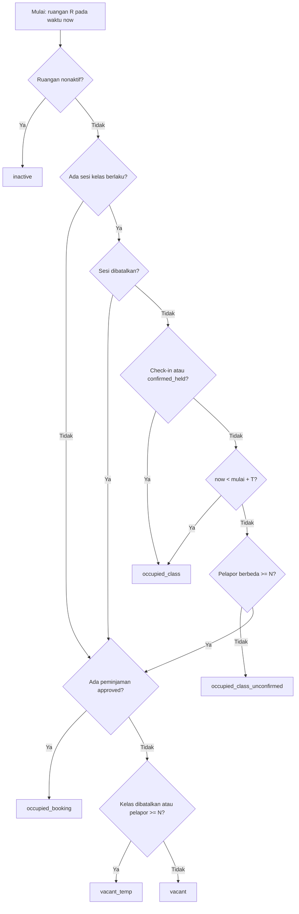
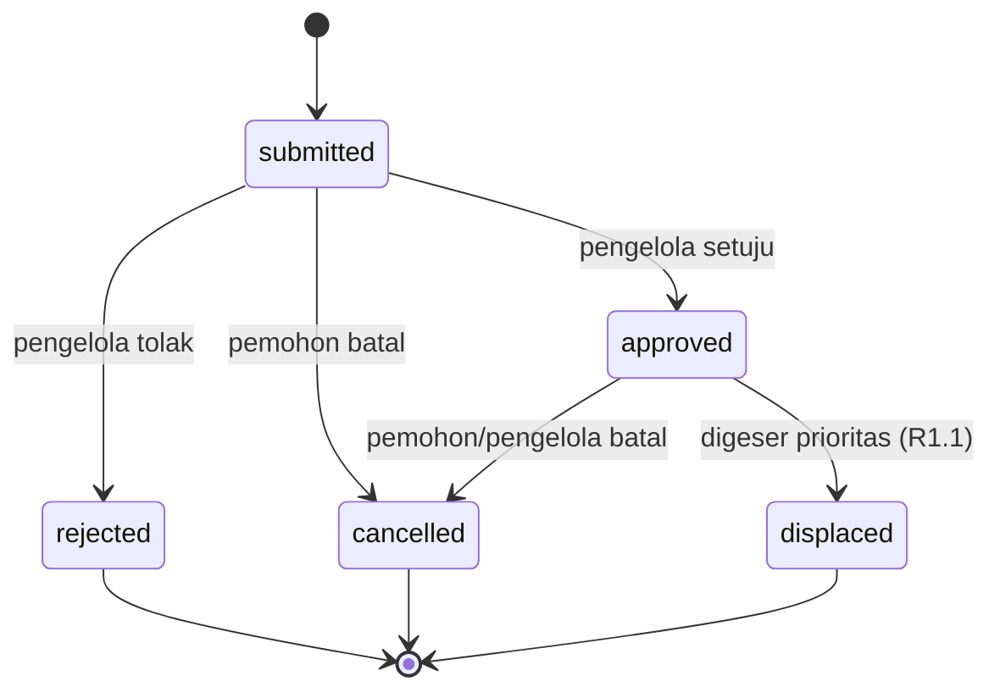
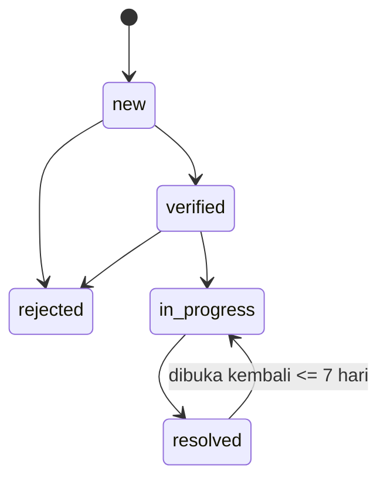

# PRD — Sistem Pengelolaan Ruangan Fakultas Teknik Unsoed

| Item | Isi |
|---|---|
| Judul dokumen | Product Requirements Document (PRD) — Sistem Pengelolaan Ruangan Fakultas Teknik Unsoed |
| Versi | 1.0 — Draft untuk review |
| Tanggal | 7 Oktober 2026 |
| Status | Draft; menunggu konfirmasi asumsi (Bagian 16) dan Open Questions (Bagian 19) |
| Pemilik produk | `[perlu data: nama pemilik produk]` |
| Platform | Website (responsif) |
| Teknologi | PHP native, MySQL; boleh memakai library CSS/JS |
| Pengguna | Mahasiswa, Dosen, Pengelola (Bapendik dan Record Center), Super Admin (asumsi) |
| Target rilis | `[perlu data]` |
| Skala dokumen | Full (Standard + lampiran) |

**Daftar bagian:** 0 Petunjuk AI Agent · 1 Ringkasan · 2 Latar belakang · 3 Tujuan & metrik · 4 Pengguna & hak akses · 5 Scope · 6 Glosarium · 7 Use case · 8 Functional requirements · 9 Business rules · 10 Status · 11 Model data · 12 Integrasi · 13 NFR · 14 Halaman · 15 Notifikasi/audit/pengaturan · 16 Asumsi · 17 Risiko · 18 Peluncuran · 19 Open questions · 20 Lampiran

## 0. Petunjuk untuk AI Agent

Bagian ini hanya ada pada versi Markdown dan ditujukan bagi AI agent yang akan membangun sistem. Versi Word untuk pembaca manusia memuat isi yang sama tanpa bagian ini.

### 0.1 Cara membaca dokumen ini

- Setiap kebutuhan memiliki **ID unik**: `FR-xxx` (fungsional), `BR-xxx` (aturan bisnis), `NFR-xxx` (non-fungsional), `A-xx` (asumsi), `OQ-xx` (pertanyaan terbuka). Rujuk ID ini pada komentar kode, pesan commit, dan nama tes.
- Prioritas: **Must** = wajib Rilis 1; **Should** = Rilis 1.1; **Could** = Rilis 2. Jangan membangun Could kecuali diminta.
- Setiap FR memiliki *Acceptance Criteria* (AC) dalam format Given/When/Then. AC adalah definisi selesai: jadikan tiap AC sebagai tes otomatis atau skenario uji manual yang tertulis.
- `[perlu data: ...]` berarti informasi belum tersedia. **Jangan mengarang nilainya.** Pakai default yang tercantum pada Asumsi (Bagian 16.2) atau Open Questions (Bagian 19), tulis sebagai konstanta di tabel `settings`, dan catat di README bagian “Keputusan sementara”.
- Jika dua bagian dokumen tampak bertentangan, prioritas keputusan: Business Rules (Bagian 9) > Status (Bagian 10) > Functional Requirements (Bagian 8) > bagian lain. Laporkan pertentangan kepada manusia, jangan memilih diam-diam.

### 0.2 Aturan kerja

1. Patuhi **Non-goals** (Bagian 3.2). Jangan menambah fitur di luar dokumen.
2. Terapkan keamanan NFR-010 s.d. NFR-016 pada **setiap** endpoint sejak awal, bukan di akhir: PDO prepared statement, escape output, token CSRF, cek peran dan kepemilikan di server, validasi unggahan, header keamanan.
3. Logika inti harus ada **satu kali** di service terpusat: (a) `RoomStatusService` (algoritma Bagian 10.1), (b) `TimeOverlap` (BR-002), (c) `BookingConflictService` (BR-010). Halaman dan API memanggilnya, tidak menghitung ulang.
4. Jangan menaruh angka sakti di kode. Semua parameter pada Bagian 15.3 dibaca dari tabel `settings`.
5. Setiap aksi pada daftar Audit (Bagian 15.2) harus memanggil helper audit log.
6. Tulis tes untuk Lampiran B dan C (status ruangan dan bentrok) sebelum mengerjakan antarmukanya.
7. Bahasa antarmuka: Bahasa Indonesia. Identifier kode, tabel, kolom, dan kode status: bahasa Inggris snake_case.
8. Jangan mengakses `$_GET/$_POST` langsung di view. Validasi input di satu lapisan (request/validator).

### 0.3 Struktur proyek yang disarankan

```text
/public               # satu-satunya folder yang di-serve web (index.php sebagai front controller, assets/)
/app
  /Controllers
  /Services           # RoomStatusService, BookingConflictService, ImportService, NotificationService, AuditLog
  /Models             # akses data (PDO) per entitas
  /Views              # templat HTML + partials
  /Support            # Csrf, Auth, Validator, Router, Settings, Uploads
/config               # config.php (di luar repositori: kredensial), config.example.php
/database             # schema.sql, seed.sql (data contoh), migrations/
/storage              # uploads/ dan logs/ (di luar webroot, tidak dapat diakses langsung)
/cron                 # send_notifications.php, cleanup_tokens.php
/tests                # tes untuk Lampiran B dan C serta AC kritis
README.md             # instalasi, konfigurasi, keputusan sementara
```

Struktur adalah **saran**, bukan kewajiban, selama prinsip pada 0.2 terpenuhi. Pustaka kecil yang diperbolehkan: PHPMailer (SMTP) dan pembaca xlsx ringan untuk FR-046.

### 0.4 Urutan pembangunan

| Milestone | Cakupan | Requirement |
|---|---|---|
| M0 Fondasi | Struktur proyek, `schema.sql`, router, layout, helper keamanan (CSRF, escape, auth), settings, audit helper, seed | NFR-010–016, NFR-019, FR-092 (helper), FR-093 |
| M1 Akun | Registrasi, verifikasi, login, reset, sesi, verifikasi dosen, antrean email | FR-001–006, FR-090 |
| M2 Data master | Gedung, ruangan, fasilitas, semester, periode tanpa kelas | FR-050–053 |
| M3 Impor jadwal | Unggah, validasi, pratinjau, terapkan, rollback, riwayat, konflik | FR-040–045 |
| M4 Ketersediaan dan pencarian | Layanan status ruangan, daftar, filter, detail, jadwal, ruangan kosong, polling, pencarian | FR-010–013, FR-020–022, FR-024, FR-030–032 |
| M5 Kehadiran kelas | Check-in, pembatalan dosen, laporan mahasiswa, ambang, verifikasi pengelola | FR-060–067 |
| M6 Peminjaman | Pengajuan, bentrok, antrean prioritas, keputusan, pembatalan, riwayat | FR-070–074, FR-076, FR-077 |
| M7 Laporan fasilitas | Buat, duplikat, siklus status, pantau, kelola, tampil di ruangan | FR-080–085 |
| M8 Penyelesaian | Dashboard, audit viewer, pengaturan, hardening, uji NFR | FR-091–093, NFR-001–009 |
| M9 Rilis 1.1 | SSO, xlsx, jadwal mingguan, geser prioritas, ekspor, entri manual | FR-007, 023, 046, 054, 075, 086 |

### 0.5 Definition of Done per requirement

- Semua AC pada FR tersebut lulus (tes otomatis atau skenario manual tertulis).
- Pemeriksaan peran dan kepemilikan di server ada dan diuji (akses oleh peran/pengguna lain ditolak).
- Input divalidasi; output di-escape; aksi mengubah data memakai CSRF token.
- Aksi bernilai audit tercatat di `audit_logs`.
- Keadaan kosong, memuat, galat, dan tanpa izin ditangani di antarmuka.
- Tidak ada nilai parameter yang di-hardcode; README diperbarui bila ada keputusan sementara baru.

### 0.6 Hal yang jangan dilakukan

- Jangan menyimpan kata sandi, token, atau kredensial SMTP/DB dalam repositori.
- Jangan menyusun SQL dengan penggabungan string dari input pengguna.
- Jangan menyimpan berkas unggahan di folder publik atau memakai nama file dari pengguna.
- Jangan menampilkan identitas pelapor kehadiran kepada siapa pun selain pengelola, dan jangan memakai data kehadiran selain untuk status ruangan (BR-008).
- Jangan membatalkan peminjaman atau jadwal secara otomatis tanpa keputusan pengelola, kecuali yang ditetapkan eksplisit dalam dokumen.
- Jangan menambah dependensi besar (framework penuh) karena batasan PHP native.

## 1. Ringkasan Eksekutif

**Sistem Pengelolaan Ruangan Fakultas Teknik Unsoed** adalah website yang membantu mahasiswa, dosen, dan pengelola fakultas mengetahui ruangan mana yang kosong atau terpakai, melihat jadwal pemakaian secara terperinci, mencari ruangan dengan cepat, meminjam ruangan di luar jadwal kelas (dosen diprioritaskan), serta melaporkan kerusakan atau kehilangan fasilitas.

Dua hal membedakan sistem ini dari sekadar daftar jadwal. **Pertama**, status ruangan tidak hanya dihitung dari jadwal, tetapi juga dari konfirmasi kehadiran dosen dan laporan mahasiswa, sehingga ruangan yang kelasnya tidak berlangsung dapat terdeteksi dan dimanfaatkan. **Kedua**, peminjaman ruangan dicek otomatis terhadap jadwal kelas dan peminjaman lain agar tidak terjadi bentrok.

Data jadwal kelas dipegang Bapendik dan dimasukkan ke sistem lewat impor CSV/Excel. Sistem dibangun dengan PHP native dan MySQL.

> **Yang diminta dari pembaca:** (1) konfirmasi asumsi di Bagian 16, (2) jawaban atas Open Questions di Bagian 19, terutama OQ-01 s.d. OQ-06, sebelum pengembangan dimulai.

## 2. Latar Belakang dan Problem Statement

### 2.1 Problem statement

Mahasiswa dan dosen Fakultas Teknik kesulitan mengetahui ruangan yang sedang kosong, jadwal pemakaiannya, dan cara meminjam ruangan di luar kelas, karena data jadwal dipegang Bapendik dan tidak tersedia terpusat serta terkini. Akibatnya waktu terbuang untuk mencari ruangan, ruangan terabaikan saat kelas tidak berlangsung, peminjaman berisiko bentrok, dan laporan kerusakan fasilitas tidak terlacak.

> Problem statement ini masih **hipotesis** yang disusun dari spesifikasi awal. `[perlu data: kondisi saat ini, cara pelaporan dan peminjaman yang berjalan, jumlah keluhan atau kejadian bentrok]`. Jangan dipakai sebagai klaim di luar tim sebelum divalidasi.

### 2.2 Kondisi saat ini (as-is) dan to-be

| Aspek | Saat ini (dugaan) | Setelah sistem berjalan |
|---|---|---|
| Info ketersediaan ruangan | Bertanya langsung, melihat ke lokasi, atau menunggu info Bapendik `[perlu data]` | Dilihat sendiri di website, diperbarui otomatis tiap 60 detik |
| Jadwal ruangan | Dipegang Bapendik, dibagikan tidak terpusat `[perlu data]` | Terpusat, bisa difilter hari dan jam |
| Kelas tidak berlangsung | Ruangan tampak terpakai di jadwal, padahal kosong | Terdeteksi lewat check-in dosen dan laporan mahasiswa |
| Peminjaman di luar kelas | `[perlu data: proses manual/surat]` | Diajukan online, dicek bentrok otomatis, disetujui pengelola, dosen diprioritaskan |
| Laporan fasilitas | `[perlu data]` | Dilaporkan online, status bisa dipantau |

## 3. Tujuan, Non-Goals, dan Metrik Keberhasilan

### 3.1 Tujuan

| ID | Tujuan |
|---|---|
| G1 | Informasi ketersediaan dan jadwal ruangan akurat, terpusat, dan mudah ditemukan. |
| G2 | Mengurangi ruangan terbuang akibat kelas tidak berlangsung, lewat deteksi kehadiran dosen. |
| G3 | Peminjaman ruangan di luar jadwal kelas tertib dan bebas bentrok, dengan prioritas untuk dosen. |
| G4 | Laporan kendala, kerusakan, dan kehilangan fasilitas terkelola dan terlacak sampai selesai. |

### 3.2 Non-goals

- Tidak menggantikan SIAKAD dan tidak menyusun jadwal kuliah; jadwal hanya diimpor dari Bapendik.
- Tidak memakai sensor IoT, kamera, atau deteksi fisik; deteksi kehadiran berbasis konfirmasi dan laporan pengguna.
- Tidak untuk menilai kinerja atau menjatuhkan sanksi kepada dosen; data kehadiran hanya dipakai untuk status ruangan.
- Tidak mengelola inventaris aset penuh, jadwal perawatan, atau penugasan teknisi.
- Tidak ada aplikasi mobile native; cukup website responsif.
- Tidak ada pembayaran atau biaya sewa ruangan.

### 3.3 Metrik keberhasilan

Semua baseline dan target di bawah adalah **usulan** dan perlu dikonfirmasi pemilik produk (OQ-13).

| Jenis | Metrik | Baseline | Target (usulan) | Sumber data |
|---|---|---|---|---|
| Utama (G1) | Waktu menemukan ruangan kosong | `[ukur]` | ≥ 80% dari 5 responden uji kegunaan selesai ≤ 30 detik | Uji kegunaan sebelum rilis |
| Utama (G1) | Ruangan dengan jadwal semester aktif terisi lengkap | 0% | 100% ruangan aktif pada minggu pertama perkuliahan | Tabel `class_schedules`, `rooms` |
| Utama (G3) | Peminjaman bentrok (double booking) disetujui | `[ukur]` | 0 kasus | Tabel `bookings` |
| Pendukung (G3) | Median waktu keputusan peminjaman | `[ukur]` | ≤ 2 hari kerja | `bookings.created_at` vs `decided_at` |
| Pendukung (G4) | Laporan fasilitas diverifikasi atau ditolak ≤ 3 hari kerja | `[ukur]` | ≥ 80% | Tabel `facility_reports` |
| Pendukung (G2) | Sesi kelas terlapor tidak hadir yang dikonfirmasi benar oleh pengelola | – | ≥ 90% | Tabel `class_sessions`, `absence_reports` |
| Adopsi | Pengguna aktif bulanan | 0 | `[tentukan]` | Tabel `users` (login terakhir) |
| Guardrail | Waktu muat halaman daftar ruangan (p95) | – | ≤ 3 detik | Log server / uji beban |
| Guardrail | Laporan palsu yang menyebabkan status keliru | – | ≤ 5% dari sesi terlapor | Keputusan pengelola |

## 4. Pengguna, Peran, dan Hak Akses

### 4.1 Persona

| Peran | Tujuan utama (JTBD) | Kesulitan |
|---|---|---|
| Mahasiswa | Menemukan ruangan kosong untuk belajar/kegiatan; memastikan kelas berlangsung di mana; meminjam ruangan; melapor kerusakan | Tidak tahu ruangan mana kosong; kelas sering tidak berlangsung tanpa kabar |
| Dosen | Menemukan ruangan untuk kuliah umum/pengganti; memastikan ruangan kelasnya tersedia; mengonfirmasi kehadiran | Ruangan bentrok; proses peminjaman tidak jelas |
| Pengelola (Bapendik / Record Center) | Memasukkan jadwal; memproses peminjaman; menindaklanjuti laporan; menjaga data ruangan | Kerja manual, informasi tersebar, sulit melacak status |
| Super Admin (teknis) | Mengelola akun pengelola, pengaturan sistem, dan audit | – |

Peran **Super Admin**, penambahan **Tamu** (tanpa login, hanya baca), dan pembagian wewenang Bapendik vs Record Center adalah **asumsi default** (A-01, A-02, A-03) yang menunggu konfirmasi.

### 4.2 Matriks hak akses

| Aksi | Tamu | Mahasiswa | Dosen | Pengelola | Super Admin |
|---|---|---|---|---|---|
| Lihat status dan jadwal ruangan | ✓ | ✓ | ✓ | ✓ | ✓ |
| Cari ruangan / gedung / jadwal | ✓ | ✓ | ✓ | ✓ | ✓ |
| Konfirmasi hadir / batalkan kelas sendiri | – | – | ✓ (terverifikasi) | – | – |
| Laporkan dosen belum hadir | – | ✓ | – | – | – |
| Verifikasi / batalkan sesi kelas | – | – | – | ✓ | ✓ |
| Ajukan peminjaman | – | ✓ | ✓ (prioritas) | ✓ | ✓ |
| Setujui / tolak peminjaman | – | – | – | ✓ | ✓ |
| Buat laporan fasilitas | – | ✓ | ✓ | ✓ | ✓ |
| Lihat laporan fasilitas sendiri | – | ✓ | ✓ | ✓ | ✓ |
| Lihat dan proses semua laporan fasilitas | – | – | – | ✓ | ✓ |
| Impor jadwal; kelola ruangan, gedung, fasilitas | – | – | – | ✓ | ✓ |
| Verifikasi akun dosen; aktif/nonaktifkan pengguna | – | – | – | ✓ | ✓ |
| Kelola akun pengelola, pengaturan sistem, audit log | – | – | – | – | ✓ |

Setiap hak akses wajib ditegakkan di **sisi server**, bukan hanya dengan menyembunyikan tombol (lihat NFR-010).

## 5. Scope dan Prioritas Rilis

| Fase | Isi | Alasan |
|---|---|---|
| Rilis 1 (MVP) — Must | Akun lokal (domain unsoed.ac.id); ketersediaan dan jadwal ruangan; pencarian; impor jadwal CSV; data master ruangan; kehadiran dosen dan laporan belum hadir; peminjaman dengan persetujuan dan prioritas dosen; laporan fasilitas; notifikasi email; audit log | Seluruh fitur inti yang diminta dan sudah dikonfirmasi pemilik produk |
| Rilis 1.1 — Should | Integrasi SSO Unsoed; impor Excel (.xlsx); tampilan jadwal mingguan; geser peminjaman karena prioritas; ekspor laporan CSV; entri jadwal manual | SSO bergantung detail dari UPT TIK; xlsx butuh library tambahan |
| Rilis 2 — Could | Peminjaman berulang; kelas pindah ruangan; saran ruangan alternatif; notifikasi WhatsApp | Nilai tambah, bukan inti |
| Tidak dikerjakan — Won't | Lihat Bagian 3.2 | – |

**Kriteria MVP selesai:** semua requirement berprioritas Must lulus acceptance criteria-nya, uji keamanan dasar (NFR-010 s.d. NFR-016) lulus, dan pilot satu gedung selama dua minggu berjalan tanpa bug kritis (Bagian 18).

## 6. Glosarium

| Istilah | Definisi |
|---|---|
| Ruangan | Ruang fisik di Fakultas Teknik yang dapat dipakai untuk kegiatan (kelas, lab, aula, ruang rapat). |
| Jadwal kelas | Pola mingguan pemakaian ruangan oleh suatu kelas mata kuliah dalam satu semester (hari, jam mulai, jam selesai). |
| Sesi kelas | Satu kemunculan jadwal kelas pada tanggal tertentu. Kehadiran dosen dicatat per sesi. |
| Semester aktif | Periode perkuliahan (tanggal mulai–selesai) yang menjadi acuan berlakunya jadwal kelas. |
| Periode tanpa kelas | Rentang tanggal tanpa perkuliahan (libur, minggu ujian) di mana jadwal kelas tidak berlaku. |
| Check-in | Konfirmasi dosen di website bahwa kelasnya berlangsung. |
| Masa tenggang (grace) | Jeda sejak jam mulai sebelum sesi dianggap belum terkonfirmasi. Default 15 menit. |
| Peminjaman | Permohonan memakai ruangan di luar jadwal kelas pada tanggal dan jam tertentu. |
| Pengelola | Pengguna dari Bapendik atau Record Center yang mengelola data dan memproses permohonan. |
| Status ruangan | Hasil perhitungan sistem untuk waktu sekarang (Bagian 10.1). |

## 7. Use Case Utama

#### UC-01 — Registrasi dan login

| Item | Isi |
|---|---|
| Aktor | Mahasiswa, Dosen |
| Prakondisi | Memiliki email aktif berdomain unsoed.ac.id |
| Alur utama | 1. Pengguna membuka halaman daftar dan mengisi nama, email, kata sandi, NIM (mahasiswa) atau NIP/NIDN (dosen)<br>2. Sistem memvalidasi domain email dan menetapkan peran awal (BR-013)<br>3. Sistem mengirim tautan verifikasi email<br>4. Pengguna membuka tautan; akun mahasiswa aktif, akun dosen berstatus menunggu verifikasi pengelola<br>5. Pengguna login dengan email dan kata sandi |
| Alur alternatif | AF-1: Pengguna login lewat SSO Unsoed (Rilis 1.1)<br>AF-2: Lupa kata sandi, memakai tautan reset email |
| Alur eksepsi | EX-1: Domain bukan unsoed.ac.id, pendaftaran ditolak dengan pesan jelas<br>EX-2: Tautan verifikasi kedaluwarsa, pengguna dapat meminta tautan baru<br>EX-3: 5 kali gagal login, akun dikunci 15 menit<br>EX-4: Email gagal terkirim, pengguna dapat kirim ulang |
| Pascakondisi | Pengguna memiliki sesi login dengan peran yang benar |

#### UC-02 — Cek ketersediaan dan jadwal ruangan

| Item | Isi |
|---|---|
| Aktor | Semua pengguna |
| Prakondisi | Data ruangan dan jadwal semester aktif sudah ada |
| Alur utama | 1. Pengguna membuka halaman Ruangan<br>2. Sistem menampilkan daftar ruangan dengan status saat ini dan keterangan “kosong hingga / terpakai hingga”<br>3. Pengguna memfilter gedung, lantai, kapasitas, atau status<br>4. Pengguna membuka detail ruangan dan melihat jadwal hari itu<br>5. Pengguna memilih hari dan rentang jam untuk melihat jadwal atau mencari ruangan kosong |
| Alur alternatif | AF-1: Pengguna memakai kolom pencarian (UC FR-030)<br>AF-2: Pengguna memilih tanggal mendatang |
| Alur eksepsi | EX-1: Tidak ada ruangan sesuai filter, tampil pesan dan saran longgarkan filter<br>EX-2: Jadwal semester belum diimpor, tampil pesan “jadwal belum tersedia” |
| Pascakondisi | Pengguna mengetahui status dan jadwal ruangan |

#### UC-03 — Impor jadwal kelas dari Bapendik

| Item | Isi |
|---|---|
| Aktor | Pengelola |
| Prakondisi | File CSV dari Bapendik; semester aktif sudah dibuat; ruangan sudah ada di data master |
| Alur utama | 1. Pengelola membuka halaman Impor Jadwal dan memilih semester<br>2. Pengelola mengunduh template (opsional) lalu mengunggah file<br>3. Sistem memvalidasi dan menampilkan pratinjau: jumlah baris valid, baris bermasalah beserta alasan<br>4. Pengelola memilih mode (tambah atau ganti jadwal semester) lalu menekan Terapkan<br>5. Sistem menyimpan dalam satu transaksi dan mencatat riwayat impor |
| Alur alternatif | AF-1: Ada baris bermasalah; pengelola memperbaiki file lalu unggah ulang, atau memilih impor baris valid saja<br>AF-2: Hasil impor salah; pengelola melakukan rollback ke impor sebelumnya |
| Alur eksepsi | EX-1: Format/enkoding/kolom wajib tidak sesuai, seluruh file ditolak dengan daftar kolom yang hilang<br>EX-2: Ruangan pada file tidak ditemukan, baris ditandai bermasalah<br>EX-3: Jadwal baru bentrok dengan peminjaman disetujui, peminjaman ditandai untuk ditinjau (FR-045) |
| Pascakondisi | Jadwal semester aktif; riwayat impor tercatat; audit log terisi |

#### UC-04 — Konfirmasi kehadiran dan laporan dosen belum hadir

| Item | Isi |
|---|---|
| Aktor | Dosen, Mahasiswa, Pengelola |
| Prakondisi | Ada sesi kelas pada hari ini; akun dosen terverifikasi dan tertaut ke jadwalnya |
| Alur utama | 1. Dosen membuka halaman Kelas Saya dan menekan Konfirmasi Hadir mulai 15 menit sebelum jam mulai<br>2. Sistem mencatat check-in dan status ruangan menjadi Terpakai (kelas)<br>3. Jika sampai jam mulai + masa tenggang belum ada check-in, status menjadi Terpakai (belum terkonfirmasi)<br>4. Mahasiswa dapat menekan Laporkan Dosen Belum Hadir<br>5. Jika jumlah pelapor berbeda mencapai ambang (default 3), status menjadi Kosong sementara dan pengelola serta dosen dinotifikasi<br>6. Pengelola memverifikasi: tetapkan Kelas tidak berlangsung, atau Kelas berlangsung |
| Alur alternatif | AF-1: Dosen mengumumkan tidak hadir/kelas dibatalkan lebih awal untuk tanggal tertentu, ruangan langsung dapat dipinjam pada slot itu<br>AF-2: Dosen check-in terlambat setelah status Kosong sementara, status kembali Terpakai dan laporan dibatalkan |
| Alur eksepsi | EX-1: Mahasiswa melapor dua kali pada sesi sama, ditolak<br>EX-2: Mahasiswa melapor sebelum masa tenggang lewat, ditolak<br>EX-3: Dosen belum tertaut ke jadwal, tidak bisa check-in; tampil instruksi menghubungi pengelola |
| Pascakondisi | Status ruangan mencerminkan kondisi sesi; keputusan tercatat di audit log |

#### UC-05 — Peminjaman ruangan

| Item | Isi |
|---|---|
| Aktor | Dosen, Mahasiswa, Pengelola |
| Prakondisi | Pengguna login; ruangan berstatus dapat dipinjam |
| Alur utama | 1. Pengguna memilih ruangan, tanggal, jam, jenis kegiatan, jumlah peserta, dan keperluan, lalu mengajukan<br>2. Sistem memeriksa aturan kelayakan dan bentrok (BR-009, BR-010)<br>3. Permohonan berstatus Diajukan dan pengelola dinotifikasi<br>4. Pengelola meninjau antrean (permohonan dosen di atas) lalu menyetujui atau menolak dengan alasan<br>5. Pemohon dinotifikasi; peminjaman disetujui tampil di jadwal ruangan |
| Alur alternatif | AF-1: Dosen dan mahasiswa mengajukan slot yang tumpang tindih; keduanya muncul sebagai konflik dan pengelola memutuskan dengan pilihan awal dosen (BR-011)<br>AF-2: Pemohon membatalkan sebelum jam mulai |
| Alur eksepsi | EX-1: Slot bentrok dengan kelas atau peminjaman disetujui, pengajuan ditolak sistem dengan alasan<br>EX-2: Dua pengelola menyetujui permohonan bertumpuk bersamaan, sistem hanya menerima satu (NFR-008)<br>EX-3: Ruangan dinonaktifkan setelah disetujui, ditandai untuk ditinjau |
| Pascakondisi | Status peminjaman final; audit log dan notifikasi tercatat |

#### UC-06 — Laporan fasilitas ruangan

| Item | Isi |
|---|---|
| Aktor | Mahasiswa, Dosen, Pengelola |
| Prakondisi | Pengguna login |
| Alur utama | 1. Pengguna memilih ruangan, kategori (kerusakan/kendala/kehilangan), fasilitas, dan mengisi deskripsi serta foto opsional<br>2. Sistem memeriksa laporan serupa yang masih aktif<br>3. Laporan tersimpan berstatus Baru dan pengelola dinotifikasi<br>4. Pengelola memverifikasi, memproses, lalu menyelesaikan dengan catatan<br>5. Pelapor memantau status dan menerima notifikasi |
| Alur alternatif | AF-1: Ada laporan serupa aktif, pengguna memilih “Saya juga mengalami” alih-alih membuat baru<br>AF-2: Pelapor membuka kembali laporan selesai dalam 7 hari |
| Alur eksepsi | EX-1: Foto bukan JPG/PNG atau lebih dari 2 MB, ditolak<br>EX-2: Deskripsi kurang dari 10 karakter, ditolak<br>EX-3: Pengguna mengakses laporan milik orang lain, ditolak (403) |
| Pascakondisi | Laporan tercatat dengan riwayat status |

## 8. Functional Requirements

Prioritas: **Must** = wajib Rilis 1; **Should** = Rilis 1.1; **Could** = Rilis 2. Kata *harus* menandakan kewajiban. Nilai default parameter (mis. masa tenggang 15 menit) disimpan di tabel pengaturan (Bagian 15.3), bukan ditulis permanen di kode.

### 8.1 Akun dan Autentikasi

#### FR-001 — Registrasi akun lokal

- **Prioritas:** Must
- **Requirement:** Sistem harus mengizinkan pendaftaran hanya dengan email berdomain unsoed.ac.id atau subdomainnya (BR-013).
- **Acceptance Criteria:**
  1. Given email @mhs.unsoed.ac.id, When mendaftar dengan data valid, Then akun dibuat berstatus pending_email dengan peran student.
  2. Given email @gmail.com, When mendaftar, Then ditolak dengan pesan “Gunakan email resmi Unsoed”.
  3. Given email sudah terdaftar, When mendaftar, Then ditolak tanpa membocorkan peran akun yang ada.

#### FR-002 — Verifikasi email

- **Prioritas:** Must
- **Requirement:** Sistem harus mengirim tautan verifikasi sekali pakai yang berlaku 24 jam.
- **Acceptance Criteria:**
  1. Given tautan valid, When dibuka, Then email_verified_at terisi dan status menjadi active (mahasiswa) atau pending_approval (dosen).
  2. Given tautan kedaluwarsa atau sudah dipakai, When dibuka, Then ditolak dan tersedia tombol kirim ulang.
  3. Token disimpan dalam bentuk hash, bukan teks asli.

#### FR-003 — Login dan penguncian akun

- **Prioritas:** Must
- **Requirement:** Sistem harus mengautentikasi dengan email dan kata sandi serta mengunci akun setelah percobaan gagal berulang (BR-014).
- **Acceptance Criteria:**
  1. Given kredensial benar dan akun aktif, When login, Then sesi dibuat dan session ID diregenerasi.
  2. Given 5 kali gagal berturut-turut, When mencoba lagi, Then akun terkunci 15 menit dan pesan tidak membedakan “email salah” atau “kata sandi salah”.
  3. Given akun pending_email atau disabled, When login, Then ditolak dengan pesan sesuai status.

#### FR-004 — Reset kata sandi

- **Prioritas:** Must
- **Requirement:** Sistem harus menyediakan reset kata sandi lewat tautan email berlaku 1 jam.
- **Acceptance Criteria:**
  1. Given email terdaftar, When meminta reset, Then tautan dikirim; given email tidak terdaftar, Then respons tampilan identik (tanpa membocorkan keberadaan akun).
  2. Setelah reset berhasil, semua sesi lama akun tersebut tidak berlaku.

#### FR-005 — Sesi dan logout

- **Prioritas:** Must
- **Requirement:** Sistem harus mengakhiri sesi setelah tidak aktif 120 menit dan menyediakan logout.
- **Acceptance Criteria:**
  1. Given tidak aktif 120 menit, When membuka halaman terproteksi, Then diarahkan ke login.
  2. Given logout, Then sesi dihancurkan dan tombol Back tidak menampilkan data terproteksi.

#### FR-006 — Verifikasi akun dosen dan manajemen pengguna

- **Prioritas:** Must
- **Requirement:** Pengelola harus dapat menyetujui akun dosen, menautkannya ke identitas dosen pada jadwal (NIP/NIDN/kode), serta mengaktifkan atau menonaktifkan pengguna.
- **Acceptance Criteria:**
  1. Given akun dosen pending_approval, When pengelola menyetujui dan menautkan NIP/NIDN, Then peran dosen aktif dan jadwal dengan identitas itu muncul di Kelas Saya.
  2. Given akun dosen belum disetujui, Then tidak dapat check-in dan tidak mendapat prioritas peminjaman.
  3. Semua tindakan tercatat di audit log.

#### FR-007 — Login SSO Unsoed

- **Prioritas:** Should
- **Requirement:** Sistem harus mendukung login lewat SSO Unsoed dan menautkannya ke akun lokal berdasarkan email. Lapisan autentikasi dirancang dapat ditukar (pluggable) agar SSO bisa ditambahkan tanpa mengubah modul lain.
- **Acceptance Criteria:**
  1. Given SSO mengembalikan identitas dengan email terdaftar, When login, Then akun lokal tertaut dan sesi dibuat.
  2. Given identitas SSO belum punya akun, Then akun dibuat otomatis dengan peran sesuai BR-013.
  3. Given SSO tidak tersedia, Then login lokal tetap berfungsi.

### 8.2 Ketersediaan Ruangan

#### FR-010 — Daftar ruangan dan status saat ini

- **Prioritas:** Must
- **Requirement:** Sistem harus menampilkan semua ruangan aktif beserta status saat ini sesuai BR-005 dan keterangan waktu: “Kosong hingga HH:MM” atau “Terpakai hingga HH:MM”. Status harus dibedakan dengan ikon dan teks, bukan hanya warna.
- **Acceptance Criteria:**
  1. Given kelas 08:00–10:00 dan sekarang 09:00 dengan check-in, Then status Terpakai (kelas) hingga 10:00.
  2. Given tidak ada kelas atau peminjaman sampai 13:00, Then status Kosong hingga 13:00.
  3. Given ruangan nonaktif, Then status Tidak tersedia.

#### FR-011 — Filter ruangan

- **Prioritas:** Must
- **Requirement:** Pengguna harus dapat memfilter berdasarkan gedung, lantai, kapasitas minimal, jenis ruangan, fasilitas, dan status.
- **Acceptance Criteria:**
  1. Given filter gedung A dan status Kosong, Then hanya ruangan gedung A berstatus Kosong yang tampil.
  2. Given kombinasi filter tanpa hasil, Then tampil pesan kosong dan tombol reset filter.

#### FR-012 — Detail ruangan

- **Prioritas:** Must
- **Requirement:** Halaman detail harus menampilkan gedung, lantai, kapasitas, jenis, fasilitas dan kondisinya, jadwal hari ini, serta laporan fasilitas yang masih aktif (FR-085).
- **Acceptance Criteria:**
  1. Given ruangan punya laporan “AC rusak” berstatus Diproses, Then tampil pada detail ruangan.
  2. Given ruangan dapat dipinjam, Then tersedia tombol Ajukan Peminjaman.

#### FR-013 — Pembaruan status berkala

- **Prioritas:** Must
- **Requirement:** Halaman daftar harus memperbarui status tanpa muat ulang halaman setiap 60 detik (polling AJAX) dan menampilkan waktu pembaruan terakhir.
- **Acceptance Criteria:**
  1. Given halaman terbuka saat kelas 08:00 berakhir pukul 10:00, When jam 10:01, Then status berubah menjadi Kosong dalam ≤ 60 detik tanpa aksi pengguna.
  2. Given koneksi gagal, Then tampil peringatan “data mungkin tidak terbaru” dan polling berlanjut.

### 8.3 Jadwal Ruangan Terperinci

#### FR-020 — Jadwal ruangan menurut hari dan jam

- **Prioritas:** Must
- **Requirement:** Pengguna harus dapat melihat jadwal sebuah ruangan dengan filter hari (atau tanggal) dan rentang jam. Default: hari ini, seluruh jam operasional.
- **Acceptance Criteria:**
  1. Given ruangan R dan hari Senin 08:00–12:00, Then hanya entri yang beririsan dengan rentang itu tampil, terurut menurut jam mulai.
  2. Given tanggal berada pada periode tanpa kelas, Then entri kelas tidak tampil dan ada keterangan periode.

#### FR-021 — Detail entri jadwal

- **Prioritas:** Must
- **Requirement:** Setiap entri harus menampilkan jenis (Kelas atau Peminjaman). Untuk Kelas: kode dan nama mata kuliah, kelas, dosen pengampu, jam mulai–selesai. Untuk Peminjaman: nama kegiatan dan jam; kontak pemohon tidak ditampilkan ke publik.
- **Acceptance Criteria:**
  1. Given entri kelas, Then tampil nama MK, kelas, dosen, dan jam.
  2. Given entri peminjaman disetujui, Then tampil nama kegiatan dan jam tanpa data kontak.

#### FR-022 — Cari ruangan kosong pada waktu tertentu

- **Prioritas:** Must
- **Requirement:** Pengguna harus dapat memilih tanggal dan rentang jam (dan opsional kapasitas minimal) untuk mendapatkan daftar ruangan yang bebas seluruh rentang tersebut.
- **Acceptance Criteria:**
  1. Given tanggal D, 13:00–15:00, Then hanya ruangan tanpa kelas aktif dan tanpa peminjaman disetujui pada rentang penuh itu yang tampil.
  2. Given kelas berakhir tepat 13:00, Then ruangan dianggap bebas mulai 13:00 (BR-002).

#### FR-023 — Tampilan jadwal mingguan

- **Prioritas:** Should
- **Requirement:** Sistem sebaiknya menyediakan grid mingguan (hari x jam) per ruangan.
- **Acceptance Criteria:**
  1. Given ruangan dipilih, Then grid Senin–Sabtu menampilkan blok kelas dan peminjaman pada jam yang benar.

#### FR-024 — Jadwal tanggal spesifik

- **Prioritas:** Must
- **Requirement:** Sistem harus menghitung jadwal untuk tanggal tertentu dari pola mingguan, override sesi, periode tanpa kelas, dan peminjaman.
- **Acceptance Criteria:**
  1. Given kelas Rabu 10:00 dan sesi tanggal itu dibatalkan dosen, Then entri tidak muncul sebagai terpakai dan slot dapat dipinjam.
  2. Given tanggal di luar semester aktif, Then tidak ada entri kelas.

### 8.4 Pencarian

#### FR-030 — Pencarian terpadu

- **Prioritas:** Must
- **Requirement:** Sistem harus menyediakan satu kolom pencarian untuk nama/kode ruangan, nama/kode gedung, mata kuliah (nama dan kode), dan nama dosen. Hasil dikelompokkan menjadi Ruangan, Gedung, dan Jadwal. Pencarian parsial dan tidak peka huruf besar/kecil, minimal 2 karakter.
- **Acceptance Criteria:**
  1. Given kata kunci “lab kom”, Then ruangan yang namanya memuat kata itu tampil di grup Ruangan.
  2. Given nama mata kuliah, Then jadwal kelas yang cocok tampil di grup Jadwal dengan ruangan, hari, dan jam.
  3. Given 1 karakter, Then tidak mencari dan tampil petunjuk minimal 2 karakter.
  4. Pencarian memakai prepared statement; karakter % dan _ pada input diperlakukan sebagai teks biasa.

#### FR-031 — Saran otomatis

- **Prioritas:** Must
- **Requirement:** Kolom pencarian harus menampilkan saran hasil (autocomplete) maksimal 8 item dengan jeda ketik 300 ms.
- **Acceptance Criteria:**
  1. Given pengguna berhenti mengetik 300 ms, Then saran muncul dalam ≤ 1 detik pada kondisi normal.
  2. Given memilih saran, Then diarahkan ke halaman terkait.

#### FR-032 — Hasil kosong

- **Prioritas:** Must
- **Requirement:** Jika tidak ada hasil, sistem harus menampilkan pesan dan saran (periksa ejaan, cari nama gedung).
- **Acceptance Criteria:**
  1. Given kata kunci tanpa kecocokan, Then tampil pesan “Tidak ada hasil untuk ‘…’” dengan HTML ter-escape.

### 8.5 Impor Jadwal Kelas (Bapendik)

Template kolom CSV yang diusulkan (final menunggu OQ-03):

```csv
course_code,course_name,class_name,lecturer_name,lecturer_ref,weekday,start_time,end_time,room_code,attendees
TI101,Algoritma dan Pemrograman,A,Nama Dosen,198001012005011001,Senin,08:00,09:40,A-101,40
```

Kolom wajib: `course_code`, `course_name`, `class_name`, `lecturer_name`, `weekday`, `start_time`, `end_time`, `room_code`. Kolom `lecturer_ref` (NIP/NIDN/kode dosen) sangat disarankan agar check-in dosen dapat berfungsi; `attendees` opsional. Nama hari boleh bahasa Indonesia (Senin–Minggu) atau angka 1–7.

#### FR-040 — Unggah file CSV

- **Prioritas:** Must
- **Requirement:** Pengelola harus dapat mengunggah CSV (UTF-8, pemisah koma atau titik koma terdeteksi otomatis), memilih semester, dan mengunduh template.
- **Acceptance Criteria:**
  1. Given file CSV valid ≤ 5 MB, Then file diterima dan diproses ke tahap pratinjau.
  2. Given file bukan CSV atau > 5 MB, Then ditolak dengan pesan.

#### FR-041 — Validasi dan pratinjau sebelum diterapkan

- **Prioritas:** Must
- **Requirement:** Sistem harus memvalidasi seluruh baris dan menampilkan pratinjau: total, valid, bermasalah, beserta alasan per baris dan unduhan laporan galat. Aturan: kolom wajib terisi; hari valid; jam format HH:MM dan mulai < selesai; room_code ada di data master; tidak ada baris ganda; tidak ada bentrok antar-jadwal pada ruangan yang sama kecuali kelas gabungan (BR-004).
- **Acceptance Criteria:**
  1. Given baris dengan start_time 10:00 dan end_time 09:00, Then baris ditandai bermasalah “jam selesai harus setelah jam mulai”.
  2. Given room_code tidak dikenal, Then ditandai bermasalah dan nama ruangan yang mirip disarankan.
  3. Given dua kelas berbeda MK pada ruangan dan jam beririsan, Then keduanya ditandai bentrok.
  4. Pratinjau tidak mengubah data jadwal aktif.

#### FR-042 — Penerapan impor

- **Prioritas:** Must
- **Requirement:** Pengelola harus dapat menerapkan impor dalam satu transaksi database dengan dua mode: Tambah/perbarui dan Ganti seluruh jadwal semester. Default hanya boleh diterapkan jika semua baris valid; pengelola dapat memilih eksplisit “impor baris valid saja”.
- **Acceptance Criteria:**
  1. Given mode Ganti, When diterapkan, Then jadwal batch lama semester itu dinonaktifkan dan batch baru aktif, atomik: bila gagal di tengah, tidak ada perubahan.
  2. Given ada baris bermasalah dan pengelola tidak memilih opsi baris valid saja, Then tombol Terapkan nonaktif.

#### FR-043 — Rollback impor

- **Prioritas:** Must
- **Requirement:** Pengelola harus dapat mengembalikan jadwal ke batch impor sebelumnya.
- **Acceptance Criteria:**
  1. Given batch B2 menggantikan B1, When rollback B2, Then B1 aktif kembali dan B2 berstatus rolled_back; tercatat di audit log.

#### FR-044 — Riwayat impor

- **Prioritas:** Must
- **Requirement:** Sistem harus menampilkan riwayat impor: waktu, pengunggah, nama file, semester, jumlah baris valid/bermasalah, status.
- **Acceptance Criteria:**
  1. Given dua impor, Then keduanya tampil terurut terbaru dan dapat dibuka detailnya.

#### FR-045 — Konflik pasca-impor

- **Prioritas:** Must
- **Requirement:** Jika jadwal baru beririsan dengan peminjaman berstatus approved, sistem harus menandai peminjaman tersebut “perlu ditinjau” dan memberi tahu pengelola, tanpa membatalkan otomatis.
- **Acceptance Criteria:**
  1. Given peminjaman approved Rabu 10:00–12:00 dan jadwal baru mengisi ruangan itu Rabu 11:00, Then peminjaman ditandai perlu ditinjau dan muncul di dashboard pengelola.

#### FR-046 — Impor Excel (.xlsx)

- **Prioritas:** Should
- **Requirement:** Sistem sebaiknya menerima .xlsx dengan kolom yang sama (membaca sheet pertama).
- **Acceptance Criteria:**
  1. Given .xlsx dengan header sesuai template, Then hasil pratinjau identik dengan CSV yang setara.

#### FR-054 — Entri jadwal manual

- **Prioritas:** Should
- **Requirement:** Pengelola sebaiknya dapat menambah, mengubah, dan menonaktifkan satu entri jadwal tanpa impor ulang.
- **Acceptance Criteria:**
  1. Given entri baru valid, Then tersimpan dan divalidasi bentrok seperti pada impor.

### 8.6 Data Master Ruangan

#### FR-050 — Kelola gedung dan ruangan

- **Prioritas:** Must
- **Requirement:** Pengelola harus dapat membuat, mengubah, dan menonaktifkan gedung dan ruangan (kode unik, nama, gedung, lantai, kapasitas, jenis, dapat dipinjam ya/tidak). Ruangan yang punya riwayat tidak boleh dihapus permanen (BR-016).
- **Acceptance Criteria:**
  1. Given kode ruangan sudah ada, When membuat ruangan, Then ditolak.
  2. Given ruangan punya jadwal atau peminjaman, When dihapus, Then hanya dapat dinonaktifkan.

#### FR-051 — Kelola fasilitas ruangan

- **Prioritas:** Must
- **Requirement:** Pengelola harus dapat mengelola daftar fasilitas per ruangan (jenis, jumlah, kondisi: baik/rusak/hilang/dalam perbaikan).
- **Acceptance Criteria:**
  1. Given fasilitas AC jumlah 2, Then dapat dipilih pada formulir laporan fasilitas ruangan itu.

#### FR-052 — Nonaktifkan ruangan sementara

- **Prioritas:** Must
- **Requirement:** Pengelola harus dapat menonaktifkan ruangan sementara beserta alasan dan perkiraan aktif kembali; ruangan nonaktif tidak dapat dipinjam (BR-019).
- **Acceptance Criteria:**
  1. Given ruangan dinonaktifkan, Then status Tidak tersedia dan pengajuan baru ditolak; peminjaman approved ke depan ditandai perlu ditinjau.

#### FR-053 — Semester dan periode tanpa kelas

- **Prioritas:** Must
- **Requirement:** Pengelola harus dapat membuat semester (nama, tanggal mulai–selesai, aktif) dan periode tanpa kelas (libur, UTS/UAS).
- **Acceptance Criteria:**
  1. Given periode tanpa kelas 10–21 Des, Then jadwal kelas tidak berlaku dan ruangan terdaftar Kosong pada rentang itu.
  2. Hanya satu semester boleh aktif pada satu waktu.

### 8.7 Kehadiran Kelas dan Deteksi Dosen Belum Hadir

Desain ini dipilih karena tidak ada sensor fisik (non-goal). Deteksi memakai tiga sumber sinyal: konfirmasi dosen, laporan mahasiswa, dan keputusan pengelola. Parameter T (masa tenggang, default 15 menit) dan N (ambang pelapor, default 3) dapat diatur.

#### FR-060 — Check-in dosen

- **Prioritas:** Must
- **Requirement:** Dosen terverifikasi harus dapat menekan Konfirmasi Hadir pada halaman Kelas Saya untuk sesi miliknya, mulai 15 menit sebelum jam mulai hingga jam selesai.
- **Acceptance Criteria:**
  1. Given sesi 08:00 dan sekarang 07:50, When dosen pemilik menekan Konfirmasi Hadir, Then sesi berstatus checked_in dengan waktu tercatat.
  2. Given sekarang 07:30, Then tombol nonaktif dengan keterangan kapan dibuka.
  3. Given dosen lain mengirim permintaan untuk sesi bukan miliknya, Then ditolak 403.

#### FR-061 — Dosen membatalkan kelas lebih awal

- **Prioritas:** Must
- **Requirement:** Dosen harus dapat mengumumkan sesi miliknya tidak berlangsung (tanggal hari ini atau mendatang) dengan alasan opsional. Slot tersebut menjadi dapat dipinjam (BR-010).
- **Acceptance Criteria:**
  1. Given sesi Rabu depan, When dosen membatalkan, Then sesi berstatus cancelled_by_lecturer, ruangan tampil Kosong pada slot itu, dan pengelola dinotifikasi.
  2. Given sesi sudah selesai, Then tidak dapat dibatalkan.

#### FR-062 — Penandaan belum terkonfirmasi

- **Prioritas:** Must
- **Requirement:** Jika sampai jam mulai + T belum ada check-in, status sesi harus dihitung sebagai belum terkonfirmasi dan ruangan tampil “Terpakai (belum terkonfirmasi)”. Dihitung saat pembacaan, tanpa cron.
- **Acceptance Criteria:**
  1. Given sesi 08:00, T=15, tanpa check-in, When 08:16, Then status ruangan Terpakai (belum terkonfirmasi).
  2. Given check-in terjadi 08:20, Then status menjadi Terpakai (kelas).

#### FR-063 — Laporan mahasiswa: dosen belum hadir

- **Prioritas:** Must
- **Requirement:** Mahasiswa login harus dapat menekan Laporkan Dosen Belum Hadir pada sesi yang belum terkonfirmasi, dengan batas anti-penyalahgunaan (BR-007).
- **Acceptance Criteria:**
  1. Given sesi belum terkonfirmasi, When mahasiswa melapor, Then laporan tersimpan dan jumlah pelapor bertambah satu.
  2. Given mahasiswa sama melapor lagi pada sesi sama, Then ditolak.
  3. Given sesi belum melewati jam mulai + T, Then tombol tidak tersedia.
  4. Given mahasiswa sudah 5 laporan hari itu, Then ditolak.

#### FR-064 — Ambang laporan menjadikan ruangan Kosong sementara

- **Prioritas:** Must
- **Requirement:** Jika jumlah pelapor berbeda mencapai N dan belum ada check-in, status ruangan harus menjadi “Kosong sementara” dan pengelola serta dosen dinotifikasi.
- **Acceptance Criteria:**
  1. Given N=3 dan 3 mahasiswa berbeda melapor, When laporan ketiga masuk, Then status Kosong sementara dan email terkirim ke pengelola dan dosen terkait.
  2. Given hanya 2 pelapor, Then status tetap Terpakai (belum terkonfirmasi).

#### FR-065 — Verifikasi pengelola

- **Prioritas:** Must
- **Requirement:** Pengelola harus dapat menetapkan sesi terlapor sebagai Tidak berlangsung (cancelled_by_manager) atau Berlangsung (confirmed_held_by_manager), dengan catatan.
- **Acceptance Criteria:**
  1. Given sesi Kosong sementara, When pengelola menetapkan Berlangsung, Then status kembali Terpakai (kelas) dan laporan ditutup.
  2. Given ditetapkan Tidak berlangsung, Then slot dapat dipinjam pada sisa waktu sesi.
  3. Keputusan tercatat di audit log dengan nama pengelola.

#### FR-066 — Check-in menggugurkan penandaan

- **Prioritas:** Must
- **Requirement:** Check-in dosen setelah ruangan Kosong sementara harus mengembalikan status ke Terpakai (kelas) dan menutup laporan terkait.
- **Acceptance Criteria:**
  1. Given status Kosong sementara, When dosen check-in, Then status Terpakai (kelas) dan pelapor tidak dinotifikasi identitas dosen.

#### FR-067 — Notifikasi kehadiran

- **Prioritas:** Must
- **Requirement:** Sistem harus mengirim notifikasi email sesuai Bagian 15.1 untuk peristiwa kehadiran.
- **Acceptance Criteria:**
  1. Given ambang tercapai, Then entri notifikasi dibuat untuk pengelola dan dosen.

#### FR-068 — Kelas pindah ruangan

- **Prioritas:** Could
- **Requirement:** Dosen atau pengelola dapat memindahkan sesi tertentu ke ruangan lain yang kosong.
- **Acceptance Criteria:**
  1. Given ruangan tujuan kosong, When dipindah, Then sesi tampil di ruangan tujuan dan ruangan asal Kosong pada slot itu.

### 8.8 Peminjaman Ruangan

#### FR-070 — Pengajuan peminjaman

- **Prioritas:** Must
- **Requirement:** Dosen dan mahasiswa harus dapat mengajukan peminjaman dengan mengisi: ruangan, tanggal, jam mulai–selesai, jenis kegiatan (kuliah umum, seminar, rapat, kegiatan organisasi, lainnya), nama kegiatan, jumlah peserta, kontak penanggung jawab, catatan, dan lampiran surat PDF opsional (≤ 2 MB).
- **Acceptance Criteria:**
  1. Given semua field wajib valid dan slot kosong, When diajukan, Then peminjaman berstatus submitted dan pengelola dinotifikasi.
  2. Given jumlah peserta melebihi kapasitas, Then pengajuan ditolak dengan menyebut kapasitas.
  3. Given lampiran bukan PDF atau > 2 MB, Then ditolak.

#### FR-071 — Validasi kelayakan dan bentrok

- **Prioritas:** Must
- **Requirement:** Sistem harus menolak pengajuan yang melanggar BR-009 dan BR-010 saat diajukan, dan memeriksanya ulang saat disetujui.
- **Acceptance Criteria:**
  1. Given slot beririsan dengan kelas aktif, Then ditolak dengan menyebut mata kuliah dan jam yang bentrok.
  2. Given slot beririsan dengan peminjaman approved, Then ditolak.
  3. Given slot beririsan dengan kelas yang dibatalkan, Then diterima.
  4. Given pengajuan 10:00–12:00 dan peminjaman approved lain 12:00–14:00, Then tidak dianggap bentrok (BR-002).
  5. Given dua permohonan bertumpuk disetujui bersamaan oleh dua pengelola, Then hanya satu berhasil dan yang lain mendapat pesan bentrok (NFR-008).

#### FR-072 — Prioritas dosen

- **Prioritas:** Must
- **Requirement:** Antrean pengelola harus mengurutkan permohonan dosen di atas mahasiswa dan menandai permohonan yang bersaing pada slot beririsan. Sistem tidak menolak otomatis; keputusan tetap di pengelola dengan pilihan awal permohonan dosen (BR-011).
- **Acceptance Criteria:**
  1. Given permohonan dosen dan mahasiswa berstatus submitted pada slot beririsan, Then keduanya ditandai “bersaing” dan permohonan dosen tampil lebih atas.
  2. Given pengelola menyetujui dosen, Then permohonan mahasiswa dapat ditolak dengan alasan templat “Diprioritaskan untuk kegiatan lain” dalam satu aksi.

#### FR-073 — Keputusan pengelola

- **Prioritas:** Must
- **Requirement:** Pengelola harus dapat menyetujui atau menolak permohonan; alasan wajib saat menolak.
- **Acceptance Criteria:**
  1. Given menolak tanpa alasan, Then ditolak oleh sistem.
  2. Given disetujui, Then status approved, pemohon dinotifikasi, dan slot tampil di jadwal ruangan.

#### FR-074 — Pembatalan oleh pemohon

- **Prioritas:** Must
- **Requirement:** Pemohon harus dapat membatalkan permohonannya sebelum jam mulai.
- **Acceptance Criteria:**
  1. Given peminjaman approved dan sekarang sebelum jam mulai, When dibatalkan, Then status cancelled dan slot kembali bebas.
  2. Given jam mulai sudah lewat, Then tombol batal tidak tersedia.

#### FR-075 — Geser karena prioritas

- **Prioritas:** Should
- **Requirement:** Pengelola sebaiknya dapat membatalkan peminjaman mahasiswa yang sudah disetujui demi kebutuhan dosen, dengan alasan wajib dan notifikasi ke pemohon (BR-011).
- **Acceptance Criteria:**
  1. Given peminjaman mahasiswa approved, When digeser, Then status displaced, alasan wajib tersimpan, pemohon dinotifikasi, audit log terisi.

#### FR-076 — Tampil di jadwal dan status

- **Prioritas:** Must
- **Requirement:** Peminjaman approved harus tampil pada jadwal ruangan dan memengaruhi status ruangan sesuai BR-005.
- **Acceptance Criteria:**
  1. Given peminjaman approved 13:00–15:00 dan sekarang 14:00, Then status Terpakai (peminjaman) hingga 15:00.

#### FR-077 — Riwayat peminjaman saya

- **Prioritas:** Must
- **Requirement:** Pengguna harus dapat melihat daftar dan status peminjamannya beserta alasan keputusan.
- **Acceptance Criteria:**
  1. Given pengguna A, Then hanya peminjaman milik A yang tampil; mengakses ID milik B menghasilkan 403.

#### FR-078 — Saran ruangan alternatif

- **Prioritas:** Could
- **Requirement:** Jika slot bentrok, sistem dapat menyarankan ruangan lain yang kosong dan memenuhi kapasitas.
- **Acceptance Criteria:**
  1. Given slot bentrok, Then maksimal 5 ruangan alternatif kosong ditampilkan.

#### FR-079 — Peminjaman berulang

- **Prioritas:** Could
- **Requirement:** Pemohon dapat mengajukan jadwal berulang mingguan.
- **Acceptance Criteria:**
  1. Given pola 4 minggu, Then 4 permohonan terhubung dibuat dan divalidasi bentrok masing-masing.

### 8.9 Pelaporan Fasilitas Ruangan

#### FR-080 — Membuat laporan fasilitas

- **Prioritas:** Must
- **Requirement:** Pengguna login harus dapat membuat laporan dengan: ruangan (wajib), kategori kerusakan/kendala/kehilangan (wajib), fasilitas dari daftar ruangan atau “Lainnya” dengan teks, deskripsi 10–1000 karakter (wajib), tingkat urgensi normal/mendesak, dan foto opsional (maks. 3 file JPG/PNG, masing-masing ≤ 2 MB).
- **Acceptance Criteria:**
  1. Given data valid, When dikirim, Then laporan berstatus new dan pengelola dinotifikasi.
  2. Given deskripsi 5 karakter, Then ditolak dengan pesan.
  3. Given berkas .php yang diganti nama jadi .jpg, Then ditolak karena pemeriksaan isi file gagal (BR-017).

#### FR-081 — Pencegahan laporan ganda

- **Prioritas:** Must
- **Requirement:** Saat memilih ruangan dan fasilitas, sistem harus menampilkan laporan aktif serupa dan menawarkan “Saya juga mengalami”.
- **Acceptance Criteria:**
  1. Given laporan “AC mati” aktif pada ruangan R, When pengguna lain memilih R dan AC, Then peringatan tampil dan pilihan menambah dukungan tersedia.
  2. Given pengguna tetap membuat laporan baru, Then diizinkan.

#### FR-082 — Siklus status laporan

- **Prioritas:** Must
- **Requirement:** Sistem harus menegakkan transisi status BR-015 dan mencatat siapa dan kapan setiap perubahan.
- **Acceptance Criteria:**
  1. Given status new, When pengelola menandai in_progress langsung, Then ditolak karena harus melalui verified.
  2. Given perubahan valid, Then riwayat status bertambah satu baris.

#### FR-083 — Pelapor memantau laporan

- **Prioritas:** Must
- **Requirement:** Pelapor harus dapat melihat daftar, status, riwayat, dan catatan pengelola atas laporannya, serta membuka kembali laporan resolved dalam 7 hari.
- **Acceptance Criteria:**
  1. Given laporan resolved 3 hari lalu, When pelapor membuka kembali, Then status in_progress.
  2. Given 8 hari, Then tombol tidak tersedia.

#### FR-084 — Pengelola mengelola laporan

- **Prioritas:** Must
- **Requirement:** Pengelola harus dapat memfilter (status, gedung, ruangan, kategori, tanggal, urgensi), mengubah status, dan menulis catatan.
- **Acceptance Criteria:**
  1. Given filter status new dan gedung A, Then hanya laporan sesuai tampil, urut urgensi lalu tanggal.

#### FR-085 — Laporan aktif tampil di detail ruangan

- **Prioritas:** Must
- **Requirement:** Laporan berstatus new, verified, dan in_progress harus tampil ringkas (kategori, fasilitas, status) pada detail ruangan; identitas pelapor tidak ditampilkan.
- **Acceptance Criteria:**
  1. Given laporan aktif, Then tampil tanpa nama pelapor; given resolved/rejected, Then tidak tampil.

#### FR-086 — Ekspor laporan

- **Prioritas:** Should
- **Requirement:** Pengelola sebaiknya dapat mengekspor daftar laporan terfilter ke CSV.
- **Acceptance Criteria:**
  1. Given filter aktif, Then CSV hanya berisi baris terfilter; sel yang diawali = + - @ diawali tanda kutip untuk mencegah injeksi rumus.

### 8.10 Notifikasi, Dashboard, dan Administrasi

#### FR-090 — Notifikasi email berantrean

- **Prioritas:** Must
- **Requirement:** Sistem harus mengirim email melalui antrean (tabel notifications) dengan percobaan ulang maksimal 3 kali, sehingga kegagalan SMTP tidak menggagalkan aksi pengguna.
- **Acceptance Criteria:**
  1. Given SMTP gagal, When aksi pengguna berhasil, Then aksi tetap tersimpan dan notifikasi berstatus failed setelah 3 percobaan.
  2. Pengiriman diproses skrip terjadwal (cron) tiap 1 menit.

#### FR-091 — Dashboard pengelola

- **Prioritas:** Must
- **Requirement:** Dashboard harus menampilkan jumlah: permohonan menunggu, permohonan bersaing, laporan fasilitas baru, sesi terlapor belum diverifikasi, peminjaman perlu ditinjau, ruangan nonaktif.
- **Acceptance Criteria:**
  1. Given 3 permohonan submitted, Then kartu Permohonan Menunggu menampilkan 3 dan menautkan ke daftar terfilter.

#### FR-092 — Audit log

- **Prioritas:** Must
- **Requirement:** Sistem harus mencatat aksi penting (login gagal berulang, perubahan peran, impor, keputusan peminjaman, perubahan status laporan, keputusan kehadiran, perubahan pengaturan) dan menampilkannya ke Super Admin dengan filter.
- **Acceptance Criteria:**
  1. Given pengelola menyetujui peminjaman, Then audit log memuat pelaku, waktu, entitas, nilai sebelum dan sesudah.
  2. Audit log tidak dapat diubah atau dihapus dari antarmuka.

#### FR-093 — Pengaturan sistem

- **Prioritas:** Must
- **Requirement:** Super Admin harus dapat mengubah parameter pada Bagian 15.3 tanpa mengubah kode.
- **Acceptance Criteria:**
  1. Given grace_minutes diubah ke 10, Then sesi berikutnya memakai 10 menit; perubahan tercatat di audit log.

## 9. Business Rules

| ID | Aturan | Terkait |
|---|---|---|
| BR-001 | Seluruh waktu memakai WIB (Asia/Jakarta), format 24 jam HH:MM. Zona waktu PHP dan sesi MySQL disetel eksplisit ke +07:00. | Semua |
| BR-002 | Rentang waktu bersifat **setengah terbuka** [mulai, selesai). Dua rentang A dan B bertabrakan jika A.mulai < B.selesai **dan** B.mulai < A.selesai. Kelas yang selesai 10:00 dan peminjaman yang mulai 10:00 **tidak** bentrok. | FR-022, FR-071 |
| BR-003 | Jadwal kelas berlaku pada tanggal D jika: batch impornya aktif; D berada dalam semester aktif; D tidak berada dalam periode tanpa kelas; dan hari D sama dengan hari pada jadwal. | FR-024, FR-053 |
| BR-004 | Dua jadwal yang beririsan pada ruangan sama **diizinkan** hanya bila `course_code` dan `lecturer_ref` sama (kelas paralel digabung). Selain itu dianggap bentrok. | FR-041 |
| BR-005 | Status ruangan dihitung sesuai algoritma Bagian 10.1. Sebelum jam mulai sesi, ruangan berstatus Kosong dengan keterangan “dipakai pukul HH:MM”; check-in dini tidak mengubah status sampai jam mulai. | FR-010, FR-062, FR-076 |
| BR-006 | Check-in dibuka 15 menit sebelum jam mulai sampai jam selesai. Masa tenggang T dihitung dari jam mulai (default 15 menit). Laporan dosen belum hadir hanya boleh dibuat pada rentang [mulai + T, selesai). | FR-060, FR-063 |
| BR-007 | Anti-penyalahgunaan laporan kehadiran: hanya peran mahasiswa; satu laporan per pengguna per sesi; maksimal 5 laporan per pengguna per hari; status Kosong sementara hanya bila ada **N pelapor berbeda** (default 3). Identitas pelapor hanya terlihat oleh pengelola. Pengelola dapat menonaktifkan akun yang terbukti menyalahgunakan. | FR-063, FR-064 |
| BR-008 | Privasi kehadiran: label publik bersifat netral (“Terpakai (belum terkonfirmasi)”, “Kosong sementara”) dan tidak memuat kata menuduh. Riwayat kehadiran per dosen hanya terlihat oleh pengelola dan Super Admin, dan tidak dipakai untuk penilaian kinerja. Kebijakan ini harus disetujui pimpinan fakultas (OQ-06). | FR-010, FR-064 |
| BR-009 | Kelayakan pengajuan peminjaman: ruangan aktif dan dapat dipinjam; pengajuan paling cepat 120 menit sebelum jam mulai dan paling jauh 90 hari ke depan; jam berada dalam jam operasional (default 07:00–21:00, Senin–Sabtu); durasi maksimal 8 jam; jam mulai < jam selesai; jumlah peserta ≤ kapasitas ruangan. | FR-070, FR-071 |
| BR-010 | Pengajuan **bentrok** jika beririsan (BR-002) dengan (a) sesi kelas yang berlaku dan tidak berstatus cancelled_by_lecturer / cancelled_by_manager, atau (b) peminjaman berstatus approved. Permohonan submitted tidak memblokir permohonan lain (keduanya bersaing), tetapi saat disetujui sistem memeriksa ulang di dalam transaksi dengan penguncian baris. | FR-071, NFR-008 |
| BR-011 | Prioritas dosen: (1) antrean pengelola diurutkan dosen terverifikasi lebih dulu, lalu mahasiswa, lalu waktu pengajuan; (2) permohonan bersaing tidak ditolak otomatis; (3) peminjaman mahasiswa yang sudah approved hanya dapat digeser oleh pengelola dengan alasan wajib dan notifikasi (Rilis 1.1); (4) prioritas dosen **tidak** mengalahkan kelas terjadwal. | FR-072, FR-075 |
| BR-012 | Batas permohonan submitted bersamaan per pengguna: mahasiswa 3, dosen 10 (dapat diatur). | FR-070 |
| BR-013 | Email wajib berakhiran `@unsoed.ac.id` atau `.unsoed.ac.id`. Domain `mhs.unsoed.ac.id` → peran student; domain `unsoed.ac.id` → peran lecturer berstatus pending_approval; domain lain dari Unsoed yang tidak terklasifikasi ditetapkan pengelola. Pengguna tidak dapat memilih peran sendiri. (Asumsi A-04.) | FR-001, FR-006 |
| BR-014 | Kata sandi minimal 8 karakter dan tidak boleh sama dengan email; disimpan dengan `password_hash()`; 5 kali gagal login berturut-turut mengunci akun 15 menit. | FR-003 |
| BR-015 | Transisi status laporan fasilitas yang valid: new→verified; new→rejected; verified→in_progress; verified→rejected; in_progress→resolved; resolved→in_progress (dibuka kembali pelapor ≤ 7 hari). Pelapor hanya dapat mengubah isi laporan selama berstatus new. | FR-082, FR-083 |
| BR-016 | Gedung, ruangan, dan pengguna yang memiliki riwayat tidak dihapus permanen; hanya dinonaktifkan. Penghapusan data pribadi atas permintaan dilakukan dengan anonimisasi. | FR-050, NFR-017 |
| BR-017 | Unggahan: ekstensi whitelist (jpg, jpeg, png untuk foto; pdf untuk lampiran), tipe diperiksa dari isi file (`finfo`), nama file diacak oleh server, disimpan di luar folder publik, dan disajikan lewat skrip yang memeriksa hak akses. | FR-070, FR-080, NFR-015 |
| BR-018 | Retensi (asumsi A-13): laporan fasilitas dan peminjaman 3 tahun; audit log 1 tahun; token verifikasi/reset dihapus setelah kedaluwarsa. | NFR-017 |
| BR-019 | Ruangan nonaktif: pengajuan baru ditolak; peminjaman approved di masa depan ditandai “perlu ditinjau” untuk keputusan pengelola. | FR-052 |

## 10. Status dan Siklus Hidup

### 10.1 Algoritma status ruangan (BR-005)

Dievaluasi saat pembacaan (tanpa cron), untuk ruangan R pada waktu sekarang `now`. Kode status yang disimpan atau dikirim API memakai bahasa Inggris snake_case; label tampil mengikuti kolom Label.

| Urut | Kondisi | Kode | Label tampil |
|---|---|---|---|
| 1 | Ruangan nonaktif | inactive | Tidak tersedia |
| 2 | Ada sesi kelas yang berlaku pada `now` (BR-003) dan (checked_in atau confirmed_held_by_manager, atau `now` < jam mulai + T tanpa check-in) | occupied_class | Terpakai (kelas) |
| 3 | Ada sesi kelas berlaku, `now` ≥ jam mulai + T, belum check-in, pelapor berbeda < N, tidak dibatalkan | occupied_class_unconfirmed | Terpakai (belum terkonfirmasi) |
| 4 | Tidak ada kelas yang berlaku, atau sesi dibatalkan/dibatalkan pengelola, atau pelapor berbeda ≥ N tanpa check-in — **dan** ada peminjaman approved pada `now` | occupied_booking | Terpakai (peminjaman) |
| 5 | Sesi kelas dibatalkan, atau pelapor berbeda ≥ N tanpa check-in, tanpa peminjaman | vacant_temp | Kosong sementara |
| 6 | Selain itu | vacant | Kosong |

Setiap status disertai keterangan waktu: “Kosong hingga HH:MM” (awal penggunaan berikutnya) atau “Terpakai hingga HH:MM”.



### 10.2 Status peminjaman

| Dari | Ke | Pemicu / aktor | Syarat | Efek samping |
|---|---|---|---|---|
| (baru) | submitted | Pemohon mengajukan | BR-009, BR-010 terpenuhi | Notifikasi ke pengelola |
| submitted | approved | Pengelola | Pemeriksaan bentrok ulang dalam transaksi lulus | Tampil di jadwal; notifikasi ke pemohon |
| submitted | rejected | Pengelola | Alasan wajib | Notifikasi ke pemohon |
| submitted / approved | cancelled | Pemohon (sebelum jam mulai) atau pengelola | Alasan wajib bila oleh pengelola | Slot bebas; notifikasi |
| approved | displaced | Pengelola (Rilis 1.1) | Alasan wajib; BR-011 | Slot bebas; notifikasi ke pemohon |

“Selesai” ditampilkan secara turunan: peminjaman approved yang jam selesainya sudah lewat. Tidak disimpan sebagai status terpisah.



### 10.3 Status laporan fasilitas

| Dari | Ke | Aktor | Syarat |
|---|---|---|---|
| (baru) | new | Pelapor | Validasi FR-080 |
| new | verified | Pengelola | – |
| new / verified | rejected | Pengelola | Alasan wajib |
| verified | in_progress | Pengelola | – |
| in_progress | resolved | Pengelola | Catatan penyelesaian |
| resolved | in_progress | Pelapor | ≤ 7 hari sejak resolved |



### 10.4 Status sesi kelas

| Status tersimpan | Arti | Dipicu oleh |
|---|---|---|
| (tidak ada baris) | Sesi berjalan sesuai jadwal, belum ada kejadian | – |
| checked_in | Dosen mengonfirmasi hadir | Dosen (FR-060, FR-066) |
| cancelled_by_lecturer | Dosen mengumumkan tidak berlangsung | Dosen (FR-061) |
| cancelled_by_manager | Pengelola menetapkan tidak berlangsung | Pengelola (FR-065) |
| confirmed_held_by_manager | Pengelola menetapkan tetap berlangsung | Pengelola (FR-065) |

Kondisi “terlapor tidak hadir” (pelapor berbeda ≥ N) **dihitung dari tabel `absence_reports`**, bukan disimpan sebagai status, agar otomatis gugur saat check-in.

## 11. Model Data

Mesin InnoDB, charset `utf8mb4`, kolom waktu pembuatan/pembaruan `created_at` dan `updated_at` pada semua tabel. Nama tabel dan kolom memakai bahasa Inggris snake_case. Skema SQL lengkap dibuat pada milestone M0 sebagai `database/schema.sql`.

| Tabel | Kolom utama | Kunci, indeks, catatan |
|---|---|---|
| users | id, email, password_hash, name, role (student/lecturer/manager/superadmin), manager_unit (bapendik/record_center, null), student_id, lecturer_ref, status (pending_email/pending_approval/active/disabled), email_verified_at, sso_subject, failed_logins, locked_until, last_login_at | UNIQUE(email); INDEX(role, status); lecturer_ref dipakai menautkan dosen ke jadwal |
| buildings | id, code, name, notes | UNIQUE(code) |
| rooms | id, building_id, code, name, floor, capacity, type (classroom/lab/hall/meeting/other), is_bookable, is_active, inactive_reason, inactive_until | UNIQUE(code); FK building_id; INDEX(building_id, is_active) |
| room_facilities | id, room_id, type, quantity, condition (good/damaged/lost/under_repair) | FK room_id |
| academic_terms | id, name, start_date, end_date, is_active | Hanya satu is_active = 1 |
| no_class_periods | id, term_id, start_date, end_date, description | FK term_id |
| schedule_imports | id, term_id, filename, uploaded_by, total_rows, valid_rows, status (preview/committed/rolled_back/failed), mode, created_at, committed_at | FK term_id, uploaded_by |
| class_schedules | id, import_id, term_id, course_code, course_name, class_name, lecturer_name, lecturer_ref, lecturer_user_id, weekday (1=Senin..7=Minggu), start_time, end_time, room_id, attendees, is_active | INDEX(room_id, weekday, start_time); INDEX(lecturer_ref); INDEX(course_code) |
| class_sessions | id, schedule_id, session_date, status (checked_in/cancelled_by_lecturer/cancelled_by_manager/confirmed_held_by_manager), checked_in_at, decided_by, note | UNIQUE(schedule_id, session_date); dibuat lazy saat ada kejadian |
| absence_reports | id, schedule_id, session_date, reporter_id, status (active/void), created_at | UNIQUE(schedule_id, session_date, reporter_id) |
| bookings | id, room_id, requester_id, requester_role, activity_name, activity_type, booking_date, start_time, end_time, attendees, contact, advisor_note, attachment_path, status (submitted/approved/rejected/cancelled/displaced), decision_reason, decided_by, decided_at, needs_review | INDEX(room_id, booking_date, status); INDEX(requester_id) |
| facility_reports | id, room_id, facility_id, facility_label, reporter_id, category (damage/issue/loss), urgency (normal/urgent), description, status, manager_note, handled_by, resolved_at | INDEX(room_id, status); INDEX(reporter_id) |
| facility_report_photos | id, report_id, path, mime | FK report_id (maks. 3 per laporan) |
| facility_report_supports | report_id, user_id | PRIMARY KEY(report_id, user_id) |
| facility_report_history | id, report_id, from_status, to_status, actor_id, note, created_at | FK report_id |
| notifications | id, user_id, type, subject, body, status (queued/sent/failed), attempts, created_at, sent_at | INDEX(status, created_at) |
| audit_logs | id, actor_id, action, entity, entity_id, old_data (JSON), new_data (JSON), ip, created_at | INDEX(entity, entity_id); INDEX(created_at); tidak ada UPDATE/DELETE dari aplikasi |
| settings | key, value, description | PRIMARY KEY(key) |
| auth_tokens | id, user_id, type (verify_email/reset_password), token_hash, expires_at, used_at | INDEX(token_hash) |

Pemeriksaan bentrok peminjaman dilakukan dalam transaksi dengan penguncian baris:

```sql
START TRANSACTION;
SELECT id FROM bookings
 WHERE room_id = :room AND booking_date = :date AND status = 'approved'
   AND start_time < :end AND end_time > :start
 FOR UPDATE;
-- jika ada baris: ROLLBACK dan tolak; jika tidak: UPDATE status menjadi approved
COMMIT;
```

## 12. Integrasi dan Dependensi

| Sistem | Arah | Data | Mekanisme | Jika gagal | Pemilik |
|---|---|---|---|---|---|
| Berkas jadwal Bapendik | Masuk | Jadwal kelas semester | Unggah CSV (Rilis 1) / xlsx (1.1) oleh pengelola | Pratinjau menolak dan menjelaskan galat; jadwal lama tetap aktif | Bapendik |
| SMTP kampus / penyedia email | Keluar | Verifikasi, reset sandi, notifikasi | SMTP (disarankan PHPMailer) | Antrean notifikasi, retry 3x; aksi pengguna tidak digagalkan | UPT TIK `[perlu konfirmasi]` |
| SSO Unsoed | Dua arah | Identitas pengguna (email, nama) | Protokol `[perlu data: OAuth2/OIDC/SAML/CAS]` | Login lokal tetap tersedia | UPT TIK `[perlu konfirmasi]` |
| Cron server | – | Pengiriman email antrean, pembersihan token | Skrip PHP tiap 1 menit | Peringatan ke Super Admin bila antrean > 100 | Pengelola hosting |
| Penyimpanan berkas | Masuk | Foto laporan, lampiran PDF | Folder di luar webroot | Unggahan gagal ditolak dengan pesan | Tim pengembang |

## 13. Non-Functional Requirements

Angka di bawah adalah usulan berdasarkan skala asumsi (≤ 5.000 pengguna terdaftar, ≤ 300 pengguna konkuren saat puncak awal semester, A-11) dan perlu divalidasi.

| ID | Kategori | Requirement | Cara ukur |
|---|---|---|---|
| NFR-001 | Performa | Halaman daftar ruangan dan jadwal: p95 ≤ 2 detik pada 300 pengguna konkuren | Uji beban |
| NFR-002 | Performa | Pencarian dan saran otomatis: p95 ≤ 1 detik | Uji beban |
| NFR-003 | Performa | Pratinjau impor 5.000 baris selesai ≤ 60 detik | Uji dengan data contoh |
| NFR-004 | Ketersediaan | 99% pada jam operasional (07:00–21:00, Senin–Sabtu) per bulan | Monitoring uptime |
| NFR-005 | Pemulihan | Backup database harian, simpan 14 hari; RPO 24 jam, RTO 1 hari kerja | Uji pemulihan sebelum rilis |
| NFR-006 | Kompatibilitas | Responsif mulai lebar 360 px; Chrome, Firefox, Edge, Safari dua versi terakhir | Uji manual |
| NFR-007 | Aksesibilitas | Kontras teks memenuhi WCAG AA; status tidak hanya dibedakan warna (ikon + teks); seluruh form dapat dioperasikan dengan keyboard | Audit manual |
| NFR-008 | Integritas data | Persetujuan peminjaman dan check-in memakai transaksi dan penguncian baris sehingga tidak terjadi double booking pada permintaan bersamaan | Uji konkurensi (2 permintaan paralel) |
| NFR-009 | Konsistensi waktu | Semua perhitungan waktu memakai zona Asia/Jakarta (BR-001) | Uji kasus batas tengah malam |
| NFR-010 | Keamanan: otorisasi | Setiap endpoint memeriksa login, peran, **dan kepemilikan data** di sisi server; ID di URL tidak boleh memberi akses ke data milik orang lain | Uji akses lintas pengguna |
| NFR-011 | Keamanan: SQL injection | Seluruh query memakai PDO prepared statement; tidak ada penyusunan SQL dari input dengan penggabungan string | Code review + uji injeksi |
| NFR-012 | Keamanan: XSS | Semua output di-escape (`htmlspecialchars` dengan ENT_QUOTES, UTF-8); header Content-Security-Policy dipasang | Uji payload XSS pada semua input teks |
| NFR-013 | Keamanan: CSRF | Semua aksi yang mengubah data memakai metode POST dengan token CSRF; cookie sesi SameSite=Lax | Uji permintaan tanpa token |
| NFR-014 | Keamanan: sesi dan sandi | `password_hash()`; cookie sesi HttpOnly dan Secure; `session_regenerate_id` saat login; pembatasan percobaan login (BR-014) | Audit konfigurasi |
| NFR-015 | Keamanan: unggahan | Aturan BR-017; berkas tidak pernah dieksekusi dan tidak dapat diakses langsung lewat URL | Uji unggah berkas berbahaya |
| NFR-016 | Keamanan: lingkungan | HTTPS wajib; kredensial di berkas konfigurasi di luar webroot dan tidak masuk repositori; pesan galat ke pengguna tidak membocorkan detail internal; header X-Content-Type-Options dan X-Frame-Options | Checklist rilis |
| NFR-017 | Privasi (UU PDP) | Data pribadi diminimalkan (nama, email, NIM/NIP); pemberitahuan penggunaan data saat registrasi; akun dapat dianonimisasi atas permintaan (BR-016) | Review kebijakan |
| NFR-018 | Observability | Log galat aplikasi ke berkas dengan rotasi; kegagalan email dan impor tercatat | Pemeriksaan log |
| NFR-019 | Maintainability | Struktur kode terpisah (routing, controller, service, view, akses data); README instalasi; `schema.sql` dan seed contoh; satu fungsi pusat untuk menghitung status ruangan dan satu untuk bentrok waktu | Review kode |

## 14. Antarmuka dan Halaman

PRD ini menetapkan perilaku dan halaman, bukan desain visual. Desain UI mengikuti identitas visual Unsoed `[perlu data: logo dan warna resmi]`. Setiap halaman harus memiliki keadaan: memuat, kosong, galat, sukses, dan tanpa izin.

| Rute (usulan) | Halaman | Akses | Requirement |
|---|---|---|---|
| / | Beranda: pencarian dan ringkasan ruangan kosong sekarang | Semua | FR-010, FR-030 |
| /rooms | Daftar ruangan dan filter | Semua | FR-010, 011, 013 |
| /rooms/{id} | Detail ruangan dan jadwal | Semua | FR-012, 020, 021, 024 |
| /free | Cari ruangan kosong pada waktu tertentu | Semua | FR-022 |
| /search | Hasil pencarian | Semua | FR-030–032 |
| /register, /login, /verify, /forgot, /reset | Akun dan autentikasi | Tamu | FR-001–004 |
| /me/classes | Kelas Saya (check-in, batalkan sesi) | Dosen | FR-060, 061 |
| /rooms/{id}/report-absent | Aksi lapor dosen belum hadir (dari detail ruangan) | Mahasiswa | FR-063 |
| /bookings/new, /me/bookings | Ajukan dan riwayat peminjaman | Mahasiswa, Dosen | FR-070, 074, 077 |
| /reports/new, /me/reports | Buat dan pantau laporan fasilitas | Login | FR-080, 081, 083 |
| /manage | Dashboard pengelola | Pengelola | FR-091 |
| /manage/imports | Impor jadwal dan riwayat | Pengelola | FR-040–045 |
| /manage/rooms, /buildings, /terms | Data master dan semester | Pengelola | FR-050–053 |
| /manage/bookings | Antrean dan keputusan peminjaman | Pengelola | FR-072, 073, 075 |
| /manage/reports | Pengelolaan laporan fasilitas | Pengelola | FR-084 |
| /manage/sessions | Verifikasi sesi terlapor | Pengelola | FR-065 |
| /manage/users | Verifikasi dosen dan kelola pengguna | Pengelola | FR-006 |
| /admin/settings, /admin/audit | Pengaturan dan audit log | Super Admin | FR-092, 093 |

## 15. Notifikasi, Audit, dan Pengaturan Sistem

### 15.1 Notifikasi email

| Peristiwa | Penerima | Isi singkat |
|---|---|---|
| Registrasi | Pengguna | Tautan verifikasi email |
| Reset sandi | Pengguna | Tautan reset (berlaku 1 jam) |
| Akun dosen disetujui | Dosen | Akun aktif |
| Permohonan peminjaman diajukan | Pengelola | Ringkasan permohonan dan tautan antrean |
| Peminjaman disetujui / ditolak / dibatalkan / digeser | Pemohon | Keputusan dan alasan |
| Laporan fasilitas baru | Pengelola | Ringkasan laporan |
| Status laporan fasilitas berubah | Pelapor | Status baru dan catatan |
| Ambang pelapor dosen belum hadir tercapai | Pengelola, Dosen terkait | Sesi, ruangan, jam; **tanpa identitas pelapor** |
| Dosen membatalkan sesi | Pengelola | Sesi dan alasan |
| Peminjaman perlu ditinjau (konflik jadwal/ruangan nonaktif) | Pengelola | Daftar peminjaman terdampak |

### 15.2 Audit log

Dicatat: login gagal berulang dan penguncian akun, perubahan peran/status akun, impor dan rollback jadwal, keputusan peminjaman, perubahan status laporan fasilitas, keputusan kehadiran, perubahan data ruangan, dan perubahan pengaturan. Setiap catatan memuat pelaku, waktu, entitas, nilai sebelum/sesudah, dan alamat IP.

### 15.3 Parameter pengaturan (tabel `settings`)

| Kunci | Default | Keterangan |
|---|---|---|
| grace_minutes | 15 | Masa tenggang T sejak jam mulai (BR-006) |
| absent_report_threshold | 3 | Ambang N pelapor berbeda (BR-007) |
| absent_reports_per_user_per_day | 5 | Batas laporan kehadiran per mahasiswa per hari |
| checkin_open_minutes_before | 15 | Check-in dibuka sebelum jam mulai |
| status_poll_seconds | 60 | Interval pembaruan status di halaman |
| booking_min_lead_minutes | 120 | Selisih minimum pengajuan dari jam mulai |
| booking_max_advance_days | 90 | Batas pengajuan ke depan |
| booking_max_duration_hours | 8 | Durasi maksimum peminjaman |
| operating_start / operating_end | 07:00 / 21:00 | Jam operasional peminjaman |
| operating_days | 1,2,3,4,5,6 | Hari operasional (1 = Senin) |
| max_submitted_bookings_student / _lecturer | 3 / 10 | Batas permohonan submitted bersamaan |
| login_max_attempts / login_lockout_minutes | 5 / 15 | Penguncian akun |
| session_idle_minutes | 120 | Batas tidak aktif |
| email_verify_hours / reset_password_minutes | 24 / 60 | Masa berlaku token |
| upload_max_mb_photo / upload_max_mb_pdf / import_max_mb | 2 / 2 / 5 | Batas ukuran berkas |
| report_reopen_days | 7 | Batas membuka kembali laporan selesai |
| notification_max_attempts | 3 | Percobaan ulang pengiriman email |

## 16. Asumsi dan Batasan

### 16.1 Batasan teknis (sudah ditetapkan pemilik produk)

- Website, bahasa pemrograman **PHP native** (tanpa framework), database **MySQL**.
- Boleh memakai library CSS dan JavaScript untuk antarmuka (disimpan lokal di proyek, tidak bergantung CDN agar tetap berjalan bila jaringan kampus membatasi akses).
- Otentikasi: akun lokal berdomain unsoed.ac.id **dan** integrasi SSO Unsoed.
- Data jadwal kelas dipegang Bapendik dan diekspor ke Excel/CSV.

### 16.2 Asumsi (mohon dikonfirmasi atau dikoreksi)

| ID | Asumsi | Dampak jika salah |
|---|---|---|
| A-01 | Ada peran Super Admin teknis di luar Pengelola | Pengelolaan akun pengelola dan pengaturan dipindah ke Pengelola |
| A-02 | Tamu (tanpa login) boleh melihat status, jadwal, dan mencari | Semua halaman baca perlu login; ubah matriks akses |
| A-03 | Bapendik dan Record Center satu peran “Pengelola” dengan wewenang sama (hanya dibedakan atribut unit di audit log) | Perlu dua peran dengan matriks wewenang berbeda |
| A-04 | Peran awal ditentukan dari domain email (mhs.unsoed.ac.id = mahasiswa; unsoed.ac.id = dosen menunggu verifikasi) | Perlu cara verifikasi lain, mis. daftar NIP dari fakultas |
| A-05 | SSO dikerjakan di Rilis 1.1 karena protokol dan kontak UPT TIK belum diketahui | Bila detail siap lebih awal, SSO dimasukkan ke MVP |
| A-06 | “Real-time” = dihitung dari jadwal, check-in, laporan, dan peminjaman, diperbarui tiap 60 detik; bukan dari sensor | Perlu perangkat tambahan di luar scope |
| A-07 | Foto laporan fasilitas opsional; laporan tidak boleh anonim | Ubah FR-080 |
| A-08 | Notifikasi hanya lewat email pada Rilis 1 | Perlu integrasi WhatsApp/Telegram (Rilis 2) |
| A-09 | Hosting mendukung PHP 8.1+, MySQL 8 atau MariaDB 10.6+, HTTPS, SMTP, dan cron; library kecil via Composer atau disalin manual (mis. PHPMailer) diperbolehkan | Sesuaikan fitur email dan impor xlsx |
| A-10 | Jam operasional peminjaman 07:00–21:00, Senin–Sabtu | Ubah pengaturan, tanpa perubahan kode |
| A-11 | Skala ≤ 5.000 pengguna terdaftar dan ≤ 300 konkuren pada puncak | Ubah target NFR performa dan kapasitas hosting |
| A-12 | CSV Bapendik berisi pola mingguan (hari + jam), bukan tanggal per pertemuan | Perlu model jadwal per tanggal |
| A-13 | Retensi: laporan dan peminjaman 3 tahun; audit log 1 tahun | Ubah kebijakan retensi (BR-018) |
| A-14 | Mahasiswa tidak wajib mencantumkan dosen pendamping atau surat; lampiran surat opsional | Tambah field wajib dan validasi di FR-070 |
| A-15 | Semua ruangan tampil ke semua pengguna; pembatasan hanya lewat penanda “tidak dapat dipinjam” | Perlu atribut visibilitas per peran |
| A-16 | Aturan peminjaman: min 2 jam sebelum mulai, maks 90 hari ke depan, maks 8 jam | Ubah pengaturan |
| A-17 | Bahasa antarmuka Bahasa Indonesia | Perlu dukungan multi-bahasa |
| A-18 | Permohonan peminjaman dapat diputuskan oleh pengelola mana pun | Perlu penugasan approver per ruangan atau unit |

## 17. Risiko dan Mitigasi

| ID | Risiko | Prob. | Dampak | Mitigasi |
|---|---|---|---|---|
| R-01 | Data jadwal tidak akurat atau tidak diperbarui, status menyesatkan, pengguna berhenti percaya | Sedang | Tinggi | Pratinjau dan validasi ketat; riwayat dan rollback impor; impor ulang saat revisi jadwal; pelatihan Bapendik |
| R-02 | Laporan dosen belum hadir disalahgunakan atau menimbulkan penolakan dari dosen | Sedang | Tinggi | Ambang N pelapor berbeda; batas harian; verifikasi pengelola; label netral; persetujuan kebijakan pimpinan (OQ-06) |
| R-03 | Dosen tidak terbiasa check-in sehingga banyak sesi “belum terkonfirmasi” | Tinggi | Sedang | Check-in satu klik di ponsel; sosialisasi; akurasi dinilai lewat metrik pendukung G2; parameter T dapat disesuaikan |
| R-04 | Pengelola lambat menindaklanjuti peminjaman dan laporan | Sedang | Sedang | Dashboard dan antrean prioritas; notifikasi; metrik median waktu keputusan |
| R-05 | Celah keamanan karena PHP native tanpa framework | Sedang | Tinggi | NFR-010 s.d. NFR-016 sebagai syarat rilis; pustaka fungsi keamanan terpusat; code review dan uji keamanan |
| R-06 | Detail SSO terlambat atau tidak tersedia | Sedang | Sedang | Login lokal sebagai jalur utama; lapisan autentikasi pluggable |
| R-07 | Peminjaman bentrok akibat permintaan bersamaan | Rendah | Tinggi | Transaksi dan penguncian baris (NFR-008); uji konkurensi |
| R-08 | Kegiatan non-kelas tidak tercatat sehingga ruangan “Kosong” sebenarnya terpakai | Tinggi | Sedang | Dorong peminjaman lewat sistem; peringatan di halaman bahwa status berdasar data terdaftar |
| R-09 | Email verifikasi masuk spam atau SMTP bermasalah | Sedang | Sedang | Antrean dan kirim ulang; SPF/DKIM bila memakai domain kampus; tombol kirim ulang |

## 18. Rencana Peluncuran

- **Strategi:** pilot satu gedung dan dua program studi selama dua minggu, lalu bertahap ke seluruh fakultas.
- **Prasyarat pilot:** data ruangan dan jadwal pilot terisi; Super Admin dan minimal dua pengelola terlatih; backup dan uji pemulihan dijalankan; checklist keamanan NFR-010 s.d. NFR-016 lulus.
- **Kriteria go/no-go:** semua requirement Must lulus AC; tidak ada bug kritis terbuka; uji kegunaan memenuhi target G1; pimpinan menyetujui kebijakan kehadiran (OQ-06).
- **Rollback:** nonaktifkan sistem dan kembali ke proses lama; data impor dapat di-rollback ke batch sebelumnya; backup database sebelum setiap impor besar.
- **Pelatihan dan dokumentasi:** panduan singkat untuk pengelola (impor, peminjaman, laporan, verifikasi kehadiran), dosen (check-in), dan mahasiswa.
- **Tinjauan metrik:** 2 minggu dan 6 minggu setelah rilis terhadap Bagian 3.3.

## 19. Open Questions

| ID | Pertanyaan | Default yang dipakai | Dibutuhkan sebelum |
|---|---|---|---|
| OQ-01 | Apakah Bapendik dan Record Center punya wewenang berbeda (siapa mengelola jadwal, siapa memproses peminjaman dan laporan)? | Satu peran Pengelola (A-03) | Desain hak akses (M0) |
| OQ-02 | Protokol SSO Unsoed (OAuth2/OIDC/SAML/CAS), kontak UPT TIK, dan atribut yang dikembalikan? | Ditunda ke Rilis 1.1 (A-05) | Rilis 1.1 |
| OQ-03 | Kolom persis pada CSV/Excel Bapendik; apakah ada NIP/NIDN/kode dosen; apakah ada daftar peserta kelas? | Template Bagian 8.5; dosen ditautkan lewat lecturer_ref | Impor jadwal (M3) |
| OQ-04 | Siapa yang menyetujui peminjaman dan berapa target waktu keputusan? | Pengelola mana pun; ≤ 2 hari kerja (A-18) | Peminjaman (M6) |
| OQ-05 | Aturan peminjaman: batas durasi, lead time, apakah mahasiswa wajib surat atau dosen pendamping? | A-14, A-16 | Peminjaman (M6) |
| OQ-06 | Apakah pimpinan fakultas menyetujui mekanisme laporan mahasiswa dan check-in dosen, termasuk nilai T dan N dan siapa yang boleh melihat riwayat kehadiran? | T = 15 menit, N = 3, riwayat hanya pengelola (BR-008) | Kehadiran (M5) dan go/no-go |
| OQ-07 | Apakah ada kalender akademik resmi (libur, UTS/UAS) yang dapat diimpor? | Pengelola memasukkan manual (FR-053) | Ketersediaan (M4) |
| OQ-08 | Hosting: versi PHP, ketersediaan cron, SMTP, HTTPS, dan siapa pengelola server? | A-09 | Awal pengembangan (M0) |
| OQ-09 | Jumlah gedung dan ruangan, serta ruangan yang tidak boleh dipinjam atau disembunyikan? | A-15 | Data master (M2) |
| OQ-10 | Ketentuan retensi data dan kebijakan privasi kampus? | A-13 | Sebelum rilis |
| OQ-11 | Apakah ada kuliah atau kegiatan pada hari Minggu atau malam hari? | A-10 | Peminjaman (M6) |
| OQ-12 | Identitas visual (logo, warna) dan siapa yang akan memelihara sistem setelah rilis? | Placeholder netral; pemelihara `[perlu data]` | Antarmuka (M0) / serah terima |
| OQ-13 | Ukuran sukses menurut pemangku kepentingan, baseline kondisi saat ini, dan tenggat rilis? | Target usulan Bagian 3.3 | Persetujuan PRD |

## 20. Lampiran

### Lampiran A — Traceability tujuan ke requirement

| Tujuan | Requirement | Aturan terkait |
|---|---|---|
| G1 Informasi akurat dan mudah ditemukan | FR-010–013, FR-020–024, FR-030–032, FR-040–046, FR-050–054 | BR-001–005 |
| G2 Deteksi kelas tidak berlangsung | FR-060–068; FR-061 dan FR-065 membebaskan slot untuk FR-070 | BR-005–008 |
| G3 Peminjaman tertib dan bebas bentrok | FR-070–079 | BR-002, BR-009–012, BR-019 |
| G4 Laporan fasilitas terlacak | FR-080–086 | BR-015, BR-017 |
| Pendukung (akun, notifikasi, admin) | FR-001–007, FR-090–093 | BR-013, BR-014, NFR-010–019 |

### Lampiran B — Skenario uji status ruangan

Kelas 08:00–10:00 pada ruangan R; T = 15 menit; N = 3; hari berlaku; tidak ada peminjaman kecuali disebutkan.

| Waktu | Kondisi | Status yang diharapkan |
|---|---|---|
| 07:50 | Belum ada check-in | vacant (“dipakai pukul 08:00”) |
| 08:05 | Belum ada check-in | occupied_class |
| 08:16 | Belum check-in, 0 pelapor | occupied_class_unconfirmed |
| 08:16 | Belum check-in, 2 pelapor berbeda | occupied_class_unconfirmed |
| 08:16 | Belum check-in, 3 pelapor berbeda | vacant_temp |
| 08:20 | Dosen check-in setelah vacant_temp | occupied_class |
| 08:30 | Sesi cancelled_by_manager | vacant_temp |
| 08:30 | Sesi cancelled_by_lecturer dan ada peminjaman approved 08:30–09:30 | occupied_booking |
| 10:00 | Kelas selesai tepat 10:00 (BR-002) | vacant |
| 08:30 | Ruangan nonaktif | inactive |
| Tanggal dalam periode tanpa kelas | Tidak ada peminjaman | vacant |

### Lampiran C — Skenario uji bentrok peminjaman

| Pengajuan | Kondisi yang ada | Hasil |
|---|---|---|
| 10:00–12:00 | Kelas 12:00–14:00 | Diterima (BR-002) |
| 11:00–13:00 | Kelas 12:00–14:00 | Ditolak, bentrok kelas |
| 11:00–13:00 | Kelas 12:00–14:00 dengan sesi tanggal itu cancelled_by_lecturer | Diterima |
| 09:00–11:00 | Peminjaman approved 10:00–12:00 | Ditolak, bentrok peminjaman |
| 09:00–11:00 | Permohonan submitted 10:00–12:00 oleh mahasiswa, pengaju dosen | Diterima; keduanya ditandai bersaing, dosen di atas antrean |
| 20:00–22:00 | Jam operasional s.d. 21:00 | Ditolak, di luar jam operasional |
| 09:00–18:30 | Durasi 9,5 jam | Ditolak, melebihi 8 jam |

